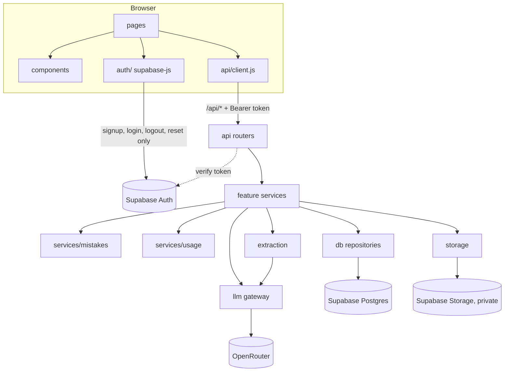
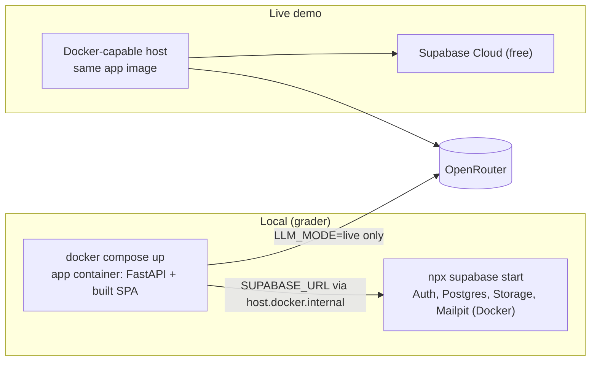
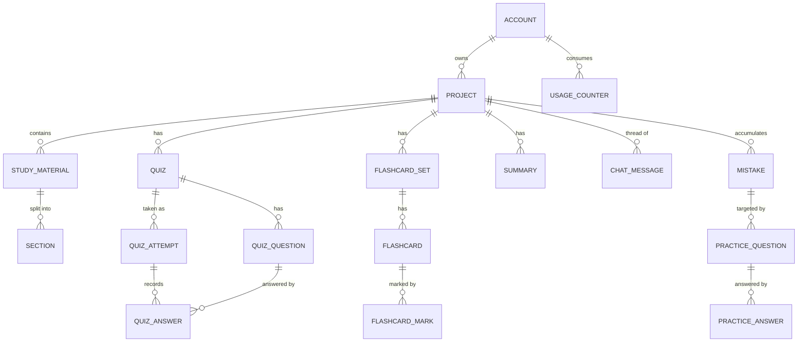

# Architecture Spine — AI Study Buddy V1

## Design Paradigm

**Layered modular monolith**, one deployable. Each backend layer may call only the layer below it. Each PRD feature is one service module.

| Layer | Location | Holds |
| --- | --- | --- |
| API | `backend/app/api/` | FastAPI routers: HTTP parsing, auth dependency, request transaction (AD-18), error envelope. No business rules. |
| Services | `backend/app/services/` | One module per feature: `projects`, `materials`, `quiz`, `flashcards`, `summaries`, `chat`, `mistakes`, `review`, `usage`. All business rules and limits. |
| Adapters | `backend/app/db/`, `storage.py`, `llm/`, `extraction/` | Postgres repositories, Supabase Storage, the LLM gateway, file-to-text conversion. |
| SPA | `frontend/src/` | `pages/` → `components/`; all HTTP through `api/client.js`; `supabase-js` only in `auth/`. |



Arrows are the only allowed dependency directions. Adapters never import services, and services never import `api`. Only these service-to-service calls are allowed:

- any service → `mistakes`
- any LLM-calling service → `usage`
- `materials` → `projects.auto_name_if_unnamed`
- `review` → `quiz` and `flashcards` read functions

## Invariants & Rules

### AD-1 — FastAPI is the only data path; the browser touches Supabase only for auth [ADOPTED]

- **Binds:** all
- **Prevents:** Two mutation paths (SPA writing tables directly vs. through the API), with limits and Mistake rules enforced in only one of them.
- **Rule:**
  - The SPA uses `supabase-js` only for sign-up, login, logout, password reset, and reading its session token. Every read or write of app data goes through `/api/*` on FastAPI.
  - The browser only ever receives the Supabase public URL and the publishable key, served at runtime by `GET /api/config` (AD-17).
  - The secret key and DB credentials exist only in the backend environment.

### AD-2 — One auth dependency; sessions capped at 30 days; every query scoped to the caller [ADOPTED]

- **Binds:** FR-1, FR-2, FR-3, all data endpoints
- **Prevents:** One student reading another's Project; token checks that differ by router or by environment; a logged-out token still working.
- **Rule:**
  - Exactly one FastAPI dependency (`app/auth.py`) turns a bearer token into `account_id`. It validates the token with `GET {SUPABASE_URL}/auth/v1/user` (one path, local and cloud).
  - It then looks up the token's `session_id` in `auth.sessions` (via `db/`):
    - Row missing (logged out) → `401 unauthorized`.
    - `created_at` older than `SESSION_MAX_AGE_DAYS` (default 30) → `401 session_expired`.

    The SPA signs out on either. This is needed because Supabase's session time-box is Pro-only.
  - Every repository function that touches Project-owned data takes `account_id` and filters by it. Any id the client sends (Section, Material, Mistake, Question) is checked to belong to the URL's Project. There is no unscoped lookup by id.
  - **Supabase Auth settings**, identical in `supabase/config.toml` and the Cloud project:
    - email confirmations **off** (FR-1: verification optional, duplicate-email error visible)
    - `site_url` and the redirect URLs for password reset set per environment (FR-3)
  - `frontend/src/auth/` maps every login failure to one generic message (FR-2).

### AD-3 — A single LLM gateway; nothing else calls a provider [ADOPTED]

- **Binds:** FR-4, FR-7, FR-10, FR-11, FR-13, FR-15, FR-16, FR-18, PRD §5.2; AGENTS.md policy
- **Prevents:** Provider calls scattered across features; unvalidated model JSON reaching the UI; a provider swap requiring edits outside one folder.
- **Rule:**
  - `backend/app/llm/` is the only code that imports `openai`. It calls OpenRouter through the official SDK with `base_url=https://openrouter.ai/api/v1`.
  - It exposes one typed function per task: `name_project`, `extract_image_text`, `generate_quiz`, `generate_flashcards`, `summarize`, `answer_chat`, `generate_practice`. Each task returns a Pydantic model from `llm/schemas.py`, never raw text or dicts.
  - Structured tasks send `response_format: json_schema` and, via `extra_body`, `provider: {require_parameters: true, data_collection: "deny"}`. The result is validated against the schema with one retry, then the gateway raises `LLMOutputError`.
  - Provider errors map to gateway exceptions: `429` → `ProviderRateLimited`, `402/403` → `ProviderUnavailable`. The API maps these to `llm_unavailable` and services never inspect HTTP codes.
  - Token estimation (`llm.estimate_tokens`) lives only here.
  - Model IDs come from config (`LLM_TEXT_MODEL`, `LLM_VISION_MODEL`). Prompts live in `llm/prompts/`.
  - Every grounded prompt labels each Section with its id, tells the model to use only the supplied material, and requires each generated item to cite the Section ids it used (SM-4, PRD §5.1).
  - Generated item schemas:
    - Questions return `options[4]` plus `correct_index`.
    - Fewer items than requested is a valid result; zero items raises `LLMOutputError`.

### AD-4 — Mock mode is part of the gateway, deterministic, and never a silent fallback in production [ADOPTED]

- **Binds:** AD-3, all tests, AGENTS.md policy
- **Prevents:** The grader needing a key; mocks drifting from the real response shape; untestable warn and reject paths; a production deploy quietly serving fake content.
- **Rule:**
  - `LLM_MODE` is `mock` or `live`.
  - In mock mode every task returns deterministic fixtures from `llm/fixtures/`, parsed through the same schemas as live output.
  - `extract_image_text` picks a `readable`, `partial`, or `unreadable` fixture by a marker in the file name (`*-partial.*`, `*-unreadable.*`). `test-data/` holds one sample per AD-6 outcome.
  - Tests always run with `LLM_MODE=mock`.
  - With `APP_ENV=development`, an unset `LLM_MODE` and no `OPENROUTER_API_KEY` resolves to `mock` and logs a warning.
  - With `APP_ENV=production`, startup fails if `LLM_MODE` is unset, or if it is `live` without `OPENROUTER_API_KEY`.
  - Quotas (AD-12) apply in mock mode too.

### AD-5 — Every Study Material becomes ordered Sections at upload; Sections are the only text features read [ADOPTED]

- **Binds:** FR-4, FR-6, FR-7, FR-8, FR-10, FR-13, FR-15, FR-16
- **Prevents:** Each feature re-parsing files its own way; image-sourced material being treated differently (violates FR-7); per-feature definitions of "a topic/section".
- **Rule:**
  - `extraction/` converts each upload to Markdown and splits it into Sections:

    | Format | One Section per | How |
    | --- | --- | --- |
    | PDF | page | `pdfplumber` `page.extract_text()` |
    | .pptx | slide | MarkItDown, split on its `<!-- Slide number: N -->` markers |
    | .docx | first-level heading | MarkItDown, split on the shallowest heading level present (no headings → one Section) |
    | .md | first-level heading | split on the shallowest heading level present (no headings → one Section) |
    | .txt | whole file | — |
    | image | whole image | gateway `extract_image_text`, after normalizing every image to JPEG (`pillow-heif` for HEIC) |

  - Sections store `material_id`, `position`, `label` (for example "Page 4" or "Slide 7: Mitosis"), the Markdown text, and a `tsvector` built with the `simple` text-search config (language-neutral).
  - Sections are immutable once created. No feature reads original files after upload.
  - **One file per upload request.** The SPA uploads several files one after another. The order inside the request is:
    1. Validate type, ≤ 50 MB, and the Project's Material count.
    2. Extract and run the integrity check (AD-6).
    3. Store the original.
    4. Run the DB transaction: lock the Project row `FOR UPDATE`, re-check ≤ 10 Materials, then insert the Material and its Sections.

    If the DB write fails, delete the stored object.

### AD-6 — Content Integrity thresholds (resolves the PRD FR-7 / §5.1 `[NOTE FOR PM]`) [ADOPTED]

- **Binds:** FR-7, PRD §5.1, SM-4
- **Prevents:** Different formats using different accept/warn/reject logic; content generated from near-empty extractions.
- **Rule:** `extraction/` returns `accepted`, `accepted_with_warning`, or `rejected`. Every number is a config default:

  | Input | Accept | Warn and continue | Reject |
  | --- | --- | --- | --- |
  | PDF, .pptx (paged) | ≥ 80 % of pages/slides are readable | 30–80 % | < 30 %, or < 200 characters in total |
  | .docx, .txt, .md (not paged) | ≥ 1,000 characters | 200–999 characters | < 200 characters |
  | .jpg/.jpeg, .png, .heic | gateway `legibility: readable` | `partial` | `unreadable`, or < 50 characters |

  - "Readable page/slide" means at least `INTEGRITY_MIN_PAGE_CHARS` characters (default 20).
  - Scanned PDF pages with no text layer are unreadable; V1 never OCRs PDF pages.
  - A file that fails to parse (corrupt, encrypted, wrong content for its extension) is rejected.
  - A rejected file is not stored, does not count toward the 10-file limit, and returns `422 material_unusable`.
  - An image consumes image quota (AD-12) once the vision call is made, whatever the outcome.
  - The warning flag is stored on the Material and shown with it.

### AD-7 — Selection Scope is a set of Section ids; grounding sends text directly, within a configured budget [ADOPTED]

- **Binds:** FR-10, FR-13, FR-15, FR-16, FR-18, SM-4
- **Prevents:** Quiz, Flashcards, and Summarize scoping differently; an unbounded prompt; a retrieval layer appearing where the PRD doesn't need one.
- **Rule:**
  - Every generation request carries one scope shape: `{"section_ids": [...]}`, or `{"whole_project": true}`, which the backend expands to all of the Project's Sections. Ask AI's narrowed scope is `{"material_id": ...}`, expanded to that Material's Sections.
  - **Quiz, Flashcards, Summarize, and Mistake Review practice:**
    - Send the scope's Section text, labelled per AD-3.
    - If `llm.estimate_tokens` exceeds `LLM_CONTEXT_BUDGET_TOKENS`, return `422 scope_too_large` and ask the student to narrow the scope. These features never retrieve.
    - The budget is configured per model and must be large enough that a whole Project of typical lecture material (10 lecture-sized Materials) fits. Refusal, with a clear "narrow your scope" message, is meant only for unusually large Projects; this is consistent with the PRD.
  - **Ask AI:** when the scope fits, send it directly. Otherwise, rank the scope's Sections by Postgres full-text match against the question and send the top Sections that fit.
  - Every generated artifact stores its scope. Every generated question, card, and chat answer stores the `source_section_ids` it cited (mapped from the model's citations and checked against the scope).
  - No embeddings or pgvector in V1.

### AD-8 — Generated artifacts are immutable; Attempts are append-only [ADOPTED]

- **Binds:** FR-8, FR-11, FR-12, FR-14, FR-16, FR-18
- **Prevents:** A Mistake or Attempt pointing to a question whose text or answer has changed; history loss (FR-18).
- **Rule:**
  - These are insert-only: Quiz and its Questions, Flashcard Sets and Cards, Summaries, Chat Messages, Practice Questions, and Sections. Regenerating creates a new artifact.
  - Answer records are insert-only, never updated or deleted: Quiz answers, Flashcard marks, and Practice answers.
  - Answers are idempotent: one answer per (Quiz Attempt, Question) and per (Practice Question, review pass). A resubmit returns the stored result.
  - Retaking a Quiz creates a new Quiz Attempt against the same saved Questions.
  - The only mutable data is `projects.name`/`name_source` (AD-14) and the Mistake lifecycle (`cleared_at`, AD-10).

### AD-9 — Quiz and practice questions are 4-option multiple choice, scored deterministically [ADOPTED]

- **Binds:** FR-10, FR-11, FR-12, FR-18, SM-C1
- **Prevents:** AI-graded or free-text answers; scores built on comparing answer text; correct answers clustering at A/B; explanations leaking before an answer.
- **Rule:**
  - Each Question is stored with exactly 4 options, ids `a`–`d` assigned by the service after it shuffles the model's `options[4]`, one `correct_option_id`, and an `explanation`. All are generated and schema-validated together.
  - Scoring is `submitted_option_id == correct_option_id` in the backend, with no LLM call. The Attempt score is the count of correct answers.
  - Question payloads sent to the SPA omit `correct_option_id` and `explanation` until that question is answered.
  - Free-text answers and AI grading are out of scope.

### AD-10 — `services/mistakes` is the sole owner of Mistakes [ADOPTED]

- **Binds:** FR-9, FR-12, FR-14, FR-17, FR-18
- **Prevents:** Duplicate outstanding Mistakes; Mistakes written from several places; a cleared item that can never fail again; normal study silently clearing a Mistake.
- **Rule:**
  - Only `services/mistakes` writes the `mistakes` table. Its interface is:
    - `record_failure(conn, account_id, project_id, source_type, source_item_id, failed_answer_id)`
    - `clear(conn, mistake_id, practice_answer_id)`, which is idempotent
    - `outstanding_count(conn, account_id, project_id)`
  - Callers:
    - `quiz` calls `record_failure` on an incorrect answer (FR-12).
    - `flashcards` calls it when a card is marked "not yet known", as FR-14 already requires. No other event creates a Mistake.
  - `source_type` is `quiz_question` or `flashcard`.
  - At most one outstanding Mistake per (`account_id`, `source_type`, `source_item_id`), enforced by a partial unique index `WHERE cleared_at IS NULL`. A repeat failure while outstanding is a no-op. A failure after clearing creates a new Mistake row, and the old row stays as history.
  - A Mistake is cleared only by a correct answer to its own Practice Question. Marking a card "known" or answering correctly in a normal retake never clears it. Practice answers never create Mistakes.
  - The FR-9 indicator is `outstanding_count` and nothing else. No stored counter.

### AD-11 — Mistake Review generates Practice Questions per outstanding Mistake, only on request [ADOPTED]

- **Binds:** FR-17, FR-18
- **Prevents:** Review sessions starting automatically; generic re-quizzes; duplicate practice from double clicks; practice inputs that differ for quiz-sourced vs. flashcard-sourced Mistakes.
- **Rule:**
  - A review starts only from an explicit student request.
  - `services/review` takes the oldest outstanding Mistakes, up to 20, and reuses any of their still-unanswered Practice Questions. It generates the rest in **one batched** `generate_practice` call. Mistakes beyond 20 stay outstanding for a later review.
  - Each target is a `PracticeTarget`: `{mistake_id, source_type, prompt_text, correct_text, source_section_ids}`. For a question, the prompt and correct text are the question and its correct option. For a card, they are the card's front and back. The source text comes from the item's own `source_section_ids`.
  - Each Practice Question (AD-9 format) stores `mistake_id`. A correct answer calls `mistakes.clear`; a wrong one leaves the Mistake outstanding.

### AD-12 — Daily quotas are atomic Postgres counters owned by `services/usage` [ADOPTED]

- **Binds:** FR-7, FR-16, PRD §5.2
- **Prevents:** Two tabs or parallel uploads both passing the last unit of quota; quotas counted in several places; failed provider calls costing the student quota.
- **Rule:**
  - `usage_counters` is keyed by (`account_id`, `usage_day`, `kind`), where `kind` is `ask_ai_message` (limit 50) or `image_extraction` (limit 25).
  - Only `services/usage` touches the table. Its interface is:
    - `reserve(kind)`: one atomic upsert that increments only `WHERE count < limit`. It returns `429 quota_exceeded` (naming the limit) when no row is updated.
    - `release(kind)`: decrements after a provider error.
  - `usage_day` is the calendar date in `QUOTA_TIMEZONE` (default `Europe/Oslo`).
  - Per-request caps (≤ 20 questions, ≤ 50 flashcards) are passed to the gateway, and the service truncates the result to the cap.

### AD-13 — All work is synchronous inside the request [ADOPTED]

- **Binds:** FR-4, FR-6, FR-7, FR-10, FR-13, FR-15, FR-16, FR-18
- **Prevents:** A job queue, worker process, or polling protocol appearing in one feature and not others.
- **Rule:**
  - Uploads (one file each, AD-5) and generation requests finish their work before returning the saved result.
  - The SPA shows a blocking progress state. The server and host request timeout is ≥ 90 s, which covers the 60 s Quiz target (FR-12 NFR).

### AD-14 — Project naming: auto-name once, never overwrite the student [ADOPTED]

- **Binds:** FR-4, FR-5
- **Prevents:** Auto-naming overwriting a student's rename; blank or unbounded names; naming failure breaking an upload.
- **Rule:**
  - A Project is created with `name = NULL` and `name_source = NULL`, which the SPA shows as the placeholder state.
  - After the upload transaction commits, `materials` calls `projects.auto_name_if_unnamed`. That runs `llm.name_project` on the first accepted Material's Sections, and sets `name`/`name_source='auto'` only while `name_source IS NULL`.
  - Auto-naming happens at most once, when the Project first has an accepted Material; once a name is set (`auto` or `student`), the system never renames the Project again.
  - Naming is best effort: a failure leaves the name `NULL`, is retried after the next accepted upload, and never fails the upload.
  - A rename (FR-5) trims the input, rejects blank input with `422 invalid_name`, caps it at 100 characters, and sets `name_source='student'`, which permanently disables auto-naming.

### AD-15 — Ask AI is one persistent thread per Project [ADOPTED]

- **Binds:** FR-16, SM-3
- **Prevents:** Conflicting thread models between API and SPA; orphan user messages replayed as history.
- **Rule:**
  - Each Project has one ordered sequence of `chat_messages` (role `user` or `assistant`).
  - A user message stores its scope (AD-7: whole Project or one `material_id`). The SPA keeps the last scope as the default for the next message.
  - The user message and its assistant answer are inserted together, only after a successful answer. A failed call stores nothing and releases quota.
  - Prior turns sent as history are capped by the context budget. The prompt states that only the current scope's material may ground the answer.

### AD-16 — Schema, storage, and environment ownership [ADOPTED]

- **Binds:** all persistence, deployment
- **Prevents:** Schema or bucket changes made in a dashboard that never reach the grader's local stack; ORM models and SQL drifting apart.
- **Rule:**
  - The database schema, the `study-materials` bucket, and its policies are defined only by SQL files in `supabase/migrations/`, applied locally by the Supabase CLI. They reach Supabase Cloud only through `npx supabase db push` from `main`.
  - The Supabase CLI is pinned as a root `devDependency`, so every `npx supabase` uses the same version.
  - The backend accesses Postgres with `psycopg` and plain SQL inside `backend/app/db/` repositories, with no ORM.
  - Originals live in the private `study-materials` bucket under `{account_id}/{project_id}/{material_id}`, read and written only by `storage.py` with the secret key.

### AD-17 — One origin, one image: FastAPI serves `/api/*` and the built SPA [ADOPTED]

- **Binds:** deployment, SPA routing, AD-1
- **Prevents:** CORS configuration; React routes returning 404 on refresh; Supabase values baked into the SPA at build time, which would need a different image per environment.
- **Rule:**
  - All API routes are under `/api/`, and an `/api/{path}` catch-all returns the JSON error envelope (`404 not_found`).
  - The built SPA is served with `app.frontend("/", directory=…, fallback="index.html")`.
  - The SPA reads `{supabase_url, supabase_publishable_key}` at startup from `GET /api/config`. No Supabase value is set at build time.
  - The backend has two URL settings: `SUPABASE_URL` (server to server; `http://host.docker.internal:54321` from the local container) and `SUPABASE_PUBLIC_URL` (what the browser uses).
  - In development, Vite proxies `/api` to `uvicorn`.

### AD-18 — One transaction per request; no LLM call inside an open write transaction

- **Binds:** all services, AD-5, AD-10, AD-12, AD-14, AD-15
- **Prevents:** A wrong answer saved without its Mistake (separate commits); DB locks held during a 30 s model call; LLM failures rolling back unrelated writes.
- **Rule:**
  - The API layer opens one DB connection per request, passes `conn` to every service and repository call, and commits or rolls back at the end.
  - Services never open connections or commit.
  - A service makes its LLM calls before writing, then does all writes in one transaction. Quota `reserve` is the only write allowed before an LLM call.

## Consistency Conventions

| Concern | Convention |
| --- | --- |
| Naming | Python `snake_case` modules and functions; React components `PascalCase.jsx`; DB tables plural `snake_case` (`projects`, `study_materials`, `sections`, `quiz_attempts`, `mistakes`); REST paths plural nouns nested under the Project: `/api/projects/{project_id}/quizzes`. |
| IDs and time | UUID primary keys (`gen_random_uuid()`); `timestamptz` stored in UTC; ISO-8601 strings in JSON. |
| API shape | JSON in `snake_case`, used as-is by the SPA. Errors are always `{"error": {"code": "<snake_code>", "message": "<student-readable text>"}}` with a matching HTTP status. Codes include `unauthorized`, `session_expired`, `not_found`, `invalid_name`, `unsupported_file_type`, `file_too_large`, `material_limit_reached`, `material_unusable`, `scope_too_large`, `quota_exceeded`, `llm_unavailable`, `llm_output_invalid`. |
| Config | All settings come from environment variables, read in one `backend/app/config.py` (Pydantic settings). Each variable name, with no value, goes into `.env.example`. There are no `VITE_*` secrets or build-time Supabase values (AD-17). |
| Logging | Python `logging`. Never log passwords, tokens, API keys, or Study Material text. Log the task name, model, duration, and outcome for each gateway call. |
| Limits | Every PRD limit is enforced in a backend service. SPA checks are UX hints only. |
| Tests | Backend `pytest`, always `LLM_MODE=mock`, against the local Supabase stack. A test asserts that no module outside `app/llm/` imports `openai`. Sample files go only in `test-data/` (small, self-made, or openly licensed). |
| Local run (grader) | `.env.example` → `.env` → `npx supabase start` → `npx supabase db reset` (migrations) → `docker compose up` → open the app. Password-reset mail arrives in Mailpit (`localhost:54324`). |

## Stack

| Name | Version |
| --- | --- |
| Python (backend, managed with uv) | 3.14 |
| FastAPI | ≥ 0.143 (uses `app.frontend`) |
| openai (Python SDK, pointed at OpenRouter) | 3.x (≥ 3.29) |
| OpenRouter API | v1 (`/api/v1/chat/completions`) |
| markitdown (`[docx,pptx]`) | 0.1.8 |
| pdfplumber | current at scaffold |
| pillow-heif | 1.8 |
| psycopg | 3.3 |
| Node.js (frontend tooling) | ≥ 22.12; 24 (Maintenance LTS) or 26 (Active LTS from 2026-10-28), set in `engines` |
| React | 19.3 |
| Vite (via `npm create vite@9`, `react` JavaScript template) | 8.x |
| @supabase/supabase-js | 2.x (≥ 2.110) |
| Supabase CLI (local stack, migrations) | pinned root devDependency, current at scaffold |
| Supabase Cloud | Free plan |
| Docker + Docker Compose | Docker Desktop current |

## Structural Seed

```text
/
  package.json              # pins Supabase CLI devDependency
  backend/
    pyproject.toml          # uv project
    app/
      main.py               # FastAPI app, routers, /api catch-all, app.frontend
      config.py             # all env settings (AD-4, conventions)
      auth.py               # the one auth dependency (AD-2)
      api/                  # routers per feature; request transaction (AD-18)
      services/             # projects, materials, quiz, flashcards, summaries, chat, mistakes, review, usage
      db/                   # psycopg connection + repositories (AD-16)
      storage.py            # private bucket access
      extraction/           # pdfplumber, MarkItDown, images, sectioning, integrity (AD-5, AD-6)
      llm/                  # gateway, schemas.py, prompts/, fixtures/ (AD-3, AD-4)
    tests/
  frontend/
    src/
      pages/  components/
      api/client.js         # only HTTP caller; attaches bearer token
      auth/                 # only supabase-js user; reads /api/config
  supabase/
    config.toml             # auth settings (AD-2)
    migrations/             # sole schema + bucket source (AD-16)
  test-data/                # small sample documents, one per AD-6 outcome
  Dockerfile                # multi-stage: build SPA, then Python runtime serving both
  docker-compose.yml        # the single app container
  .env.example
```





`ACCOUNT` is Supabase's `auth.users`. The app adds no account table. A `MISTAKE` points at its source item through (`source_type`, `source_item_id`); that is a polymorphic link, so it is not drawn.

## Capability → Architecture Map

| Capability | Lives in | Governed by |
| --- | --- | --- |
| Account & Authentication (FR-1–3) | Supabase Auth via `frontend/src/auth/`; `backend/app/auth.py`; `supabase/config.toml` | AD-1, AD-2 |
| Projects, naming, resume, indicator (FR-4, FR-5, FR-8, FR-9) | `services/projects`, `services/mistakes` | AD-8, AD-10, AD-14 |
| Upload and extraction (FR-6, FR-7, §5.1) | `services/materials`, `extraction/`, `storage.py` | AD-5, AD-6, AD-12, AD-13, AD-16, AD-18 |
| Quiz (FR-10–12) | `services/quiz` | AD-7, AD-8, AD-9, AD-10, AD-18 |
| Flashcards (FR-13, FR-14) | `services/flashcards` | AD-7, AD-8, AD-10, AD-18 |
| Summarize (FR-15) | `services/summaries` | AD-7, AD-8 |
| Ask AI (FR-16) | `services/chat` | AD-7, AD-12, AD-15, AD-18 |
| Mistake Review (FR-17, FR-18) | `services/review`, `services/mistakes` | AD-9, AD-10, AD-11 |
| Cost controls (§5.2) | `services/usage`, `llm/` | AD-3, AD-12 |
| Mock mode (AGENTS.md) | `llm/` | AD-3, AD-4 |

## Deferred

- **Hosting provider for the live demo:** picked during release work. The host must run the AD-17 Docker image, allow requests ≥ 90 s, and accept 50 MB request bodies.
- **Supabase Cloud operations:** a free project pauses after inactivity, so wake it before demos. Configure a real SMTP provider before the live demo, because the built-in mailer is restricted, and password reset (FR-3) must work there. Mirror AD-2's auth settings in the dashboard.
- **OpenRouter account strategy (owner: the team, before the first live demo):** free-model limits are per OpenRouter account (50/day under $10 of credits, 1,000/day at ≥ $10). Decide between buying $10 of credits for free models or using a cheap paid model with a spend limit on the key. Use a separate key for the demo.
- **Concrete model IDs and `LLM_CONTEXT_BUDGET_TOKENS`:** set in `.env` once tested. The chosen models must offer structured output (and, for `LLM_VISION_MODEL`, image input) under `data_collection: "deny"`.
- **UI design, styling approach, component library, client routing library:** owned by `bmad-ux` and the first frontend story. AD-1 and AD-17 must still hold.
- **Showing answer sources in the UI:** the data is stored (AD-7). Displaying it is post-V1 unless a story asks.
- **Deleting Projects or Materials:** not in the PRD, so a full Project (10 Materials) stays full in V1. If added later, delete within the Project only, and keep the history AD-8 requires.
- **CI pipeline and frontend test runner:** decided when the first stories land.
- **Embeddings / pgvector retrieval:** a V2 candidate if full-text retrieval proves weak.
- **Rate-limit backoff beyond AD-3's single schema retry:** add only if the demo hits `429`s.
