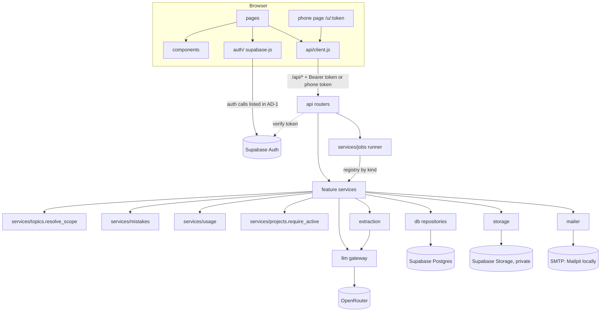
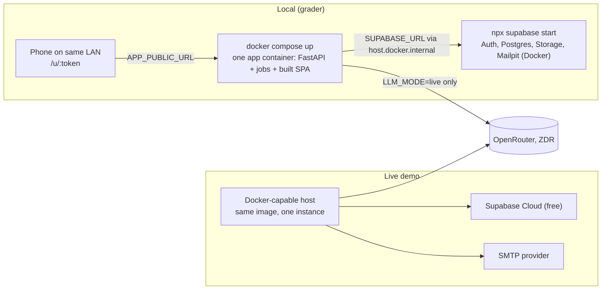
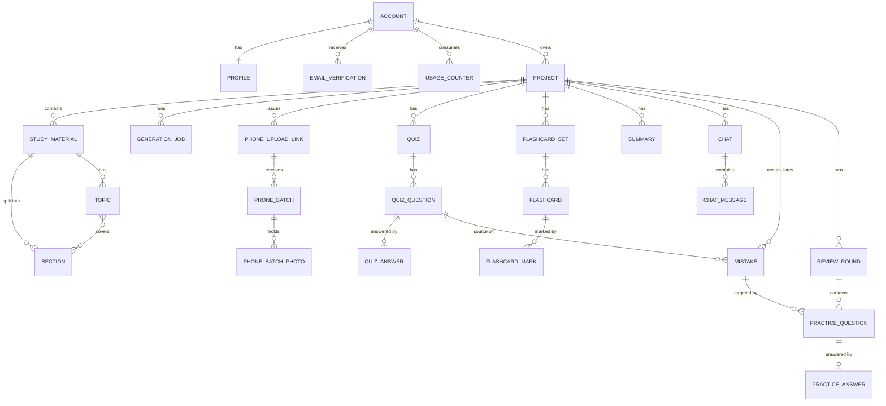

# Architecture Spine — AI Study Buddy V1

## Design Paradigm

**Layered modular monolith**, one deployable and one running instance. Each backend layer may call only the layer below it. Each PRD feature is one service module. Long work runs as in-process background jobs (AD-20) on an async runtime (AD-29).

| Layer | Location | Holds |
| --- | --- | --- |
| API | `backend/app/api/` | FastAPI routers: HTTP parsing, the two auth dependencies (AD-2), request transaction (AD-18), mapping domain errors to HTTP. No business rules. |
| Services | `backend/app/services/` | One module per feature: `identity`, `projects`, `materials`, `topics`, `quiz`, `flashcards`, `summaries`, `chat`, `mistakes`, `review`, `history`, `usage`, `phone`, `jobs`. All business rules and limits. Services raise domain errors, never HTTP responses. |
| Adapters | `backend/app/db/`, `storage.py`, `mailer.py`, `llm/`, `extraction/` | Postgres repositories, Supabase Storage, outgoing SMTP, the LLM gateway, file-to-text conversion. |
| SPA | `frontend/src/` | `pages/` → `components/`; all HTTP through `api/client.js`; `supabase-js` only in `auth/`; all strings in `i18n/`; all colours, type, and spacing in `styles/tokens.css`. |



Arrows are the only allowed dependency directions. Adapters never import services, and services never import `api`. Only these service-to-service calls are allowed:

- **Called from any service:**
  - `mistakes`
  - `usage`
  - `projects.require_active`
  - `jobs.enqueue` and `jobs.cancel_for_*`
- **Called from the generating services** (`quiz`, `flashcards`, `summaries`, `chat`, `review`) **and from capacity:** `topics.resolve_scope`
- **Other allowed calls:**
  - `jobs` → each feature's registered `run_job`/save-plan handler, keyed by `kind`
  - `materials` → `topics`, `projects.auto_name_if_unnamed`
  - `phone` → `materials.create_from_batch`
  - `materials` and `phone` → `identity.require_privacy_ack`
  - `projects` → `phone.revoke_for_project`
  - `review` → `quiz` read functions
  - `history` → read functions of `chat`, `quiz`, `flashcards`, `summaries`
  - `identity` and `projects` → `projects.purge` (AD-22)

## Invariants & Rules

### AD-1 — FastAPI is the only data path; the browser touches Supabase only for auth [ADOPTED]

- **Binds:** all
- **Prevents:** Two mutation paths (SPA writing tables directly vs. through the API), with limits and Mistake rules enforced in only one of them.
- **Rule:**
  - The SPA's `supabase-js` calls are limited to:
    - sign-up and password login
    - `signInWithOAuth` and `linkIdentity` for Google
    - logout and reading the session token
    - completing a password reset from the emailed link
    - `updateUser({password})` for an Account that has a password

    It never calls `updateUser({email})`. After sign-up, after every sign-in, and after a completed reset, the SPA calls the matching `/api/auth/after-*` endpoint (AD-19).
  - A password-reset *request* goes through `POST /api/auth/password-reset`. Every read or write of app data goes through `/api/*`.
  - The browser only ever receives `{supabase_url, supabase_publishable_key, google_enabled}`, served at runtime by `GET /api/config` (AD-17). The secret key, DB credentials, SMTP credentials, and OpenRouter key exist only in the backend environment.

### AD-2 — Exactly two auth dependencies; sessions capped at 30 days; every query scoped [ADOPTED]

- **Binds:** FR-1, FR-2, FR-3, FR-19, FR-21, all data endpoints
- **Prevents:** One student reading another's Project; token checks that differ by router or environment; a logged-out token still working; the phone link doing more than adding photos; Supabase settings drifting between local and cloud.
- **Rule:**
  - **`user_auth`** (`app/auth.py`) turns a bearer token into `account_id`:
    1. Validate the token with `GET {SUPABASE_URL}/auth/v1/user`.
    2. Look up the token's `session_id` in `auth.sessions` (via `db/`):
       - row missing (logged out, or ended by a reset or takeover) → `unauthorized`
       - `created_at` NULL, or older than `SESSION_MAX_AGE_DAYS` (default 30) → `session_expired`
    3. Create the `profiles` row idempotently (`INSERT … ON CONFLICT DO NOTHING`).
    4. Enforce the Google takeover (AD-19).

    The SPA signs out on `unauthorized` or `session_expired`, keeping the intended route in `sessionStorage` so the student returns to the same Project after logging in again (FR-2).
  - **`phone_link_auth`** (AD-24) accepts only a phone-link token and only for routes under `/api/phone/`. No other code parses tokens.
  - **Scoping:** every repository function that touches Project-owned data takes `account_id` and filters by it. Any id the client sends (Topic, Material, Mistake, Question, Chat, Job) is checked to belong to the URL's Project. There is no unscoped lookup by id.
  - **System-context exceptions**, a closed list:
    - the purge task (AD-22)
    - the startup sweep and the job runner, scoped by the job row (AD-20)
    - the stale phone-batch cleanup (AD-24)
    - token-hash lookups for phone links and email verification
  - **Supabase Auth settings** live in `supabase/config.toml`, and the Cloud project is set to the same values:
    - `enable_confirmations = false`, because with confirmations on, unverified users can't log in (FR-1); verification is app-level (AD-19)
    - `minimum_password_length = 8`
    - `enable_manual_linking = true`
    - `otp_expiry = 3600`, for 1 h recovery links (FR-3)
    - Google `enabled = env(SUPABASE_AUTH_EXTERNAL_GOOGLE_ENABLED)` (default false), with the client id and secret via `env()`; `google_enabled` in `/api/config` comes from the same variable
    - `site_url` and the redirect URLs (`/auth/callback`, the reset route) set per environment
  - `frontend/src/auth/` maps every login failure to one generic message (FR-2).

### AD-3 — A single LLM gateway; nothing else calls a provider [ADOPTED]

- **Binds:** FR-4, FR-7, FR-10, FR-11, FR-13, FR-15, FR-16, FR-18, FR-22, FR-29, PRD §5.1–§5.3; AGENTS.md policy
- **Prevents:** Provider calls scattered across features; unvalidated model output reaching the UI; student material retained by a provider; services and gateway handling bad citations differently; a provider swap requiring edits outside one folder.
- **Rule:**
  - **The only importer.** `backend/app/llm/` is the only code that imports `openai`. It uses `AsyncOpenAI` with `base_url=https://openrouter.ai/api/v1` and `timeout=LLM_TIMEOUT_SECONDS`.
  - **One typed function per task:** `name_project`, `extract_image_text`, `detect_topics`, `generate_quiz`, `generate_flashcards`, `summarize`, `generate_practice`, `answer_chat_stream`.
    - Every task except `answer_chat_stream` returns a Pydantic model from `llm/schemas.py`.
    - `answer_chat_stream` is the one raw-text exception (AD-25). It yields text deltas, then a validated `sources` list.
  - **Request settings.** Every live request sends, via `extra_body`, `provider: {require_parameters: true, data_collection: "deny", zdr: true}`. Structured tasks also send `response_format: json_schema`; the result is validated against the schema with one retry, then the gateway raises `LLMOutputError`.
  - **Errors.** Provider errors become gateway exceptions, which the API maps to `llm_unavailable`:
    - `429` → `ProviderRateLimited`
    - `402/403` → `ProviderUnavailable`
    - a mid-stream chunk with `error` or `finish_reason: "error"` (sent with HTTP 200) → `ProviderStreamError`
  - **Configuration.** Only this module estimates tokens (`llm.estimate_tokens`). Model IDs come from config (`LLM_TEXT_MODEL`, `LLM_VISION_MODEL`). Prompts live in `llm/prompts/`.
  - **Grounding and citations (SM-4, §5.1):**
    - The gateway labels the supplied Sections (and practice targets) locally as `S1…Sn` and maps citations back to Section ids. Callers only ever see Section ids.
    - Every prompt tells the model to use only the supplied material, to cite labels for each item, summary section, practice question, and chat answer, and to write in the material's main language (FR-29).
    - Topic-scoped prompts list the Topics and forbid content for a Topic the material doesn't cover (FR-22).
    - An item with no valid citation is dropped.
  - **Item schemas:**
    - Questions return `options[4]` plus `correct_index`.
    - Fewer items than requested is a valid result; zero items (after dropping uncited ones) raises `LLMOutputError`.

### AD-4 — Mock mode is part of the gateway, deterministic, and never a silent fallback in production [ADOPTED]

- **Binds:** AD-3, all tests, AGENTS.md policy
- **Prevents:** The grader needing a key; mocks drifting from the real response shape; untestable warn, reject, count, progress, and cancel paths; a production deploy quietly serving fake content.
- **Rule:**
  - `LLM_MODE` is `mock` or `live`. In mock mode every task returns deterministic output from template fixtures in `llm/fixtures/`, parsed through the same schemas and citation mapping as live output.
  - Fixtures cite local labels (`S1…`). Generation fixtures return `min(requested, capacity)` items.
  - `detect_topics` derives topics deterministically from the Section count.
  - `answer_chat_stream` streams its fixture in chunks.
  - `extract_image_text` picks a `readable`, `partial`, or `unreadable` fixture per image by a marker in the file name (`*-partial.*`, `*-unreadable.*`). `test-data/` holds one sample per AD-6 outcome.
  - `LLM_MOCK_DELAY_MS` (default 0) delays every mock task, so that progress steps and cancel can be exercised.
  - Tests always run with `LLM_MODE=mock`.
  - With `APP_ENV=development`, an unset `LLM_MODE` and no `OPENROUTER_API_KEY` resolves to `mock` and logs a warning.
  - With `APP_ENV=production`, startup fails if `LLM_MODE` is unset, or if it is `live` without `OPENROUTER_API_KEY`.
  - Quotas (AD-12) apply in mock mode too.

### AD-5 — Every Study Material becomes ordered Sections in a processing job; `services/materials` owns Material state [ADOPTED]

- **Binds:** FR-4, FR-6, FR-7, FR-8, FR-10, FR-13, FR-15, FR-16, FR-20, FR-21, FR-22
- **Prevents:** Each feature re-parsing files its own way; image-sourced material treated differently (FR-7); different slot-count rules; a Material stuck in "Reading…" holding a slot; full text written back after removal.
- **Rule:**
  - **Sections.** `extraction/` converts each upload to Markdown and splits it into Sections:

    | Format | One Section per | How |
    | --- | --- | --- |
    | PDF | page | `pdfplumber` `page.extract_text()` |
    | .pptx | slide | MarkItDown, split on its `<!-- Slide number: N -->` markers |
    | .docx, .md | ~500 words | MarkItDown for .docx; split at headings, then pack or split to about 500 words |
    | .txt | ~500 words | chunks of about 500 words |
    | image | whole image | gateway `extract_image_text`, after normalizing every image to JPEG (`pillow-heif` for HEIC) |
    | phone batch (AD-24) | photo | as for an image; labelled "Page n" |

    Sections store `material_id`, `position`, `label` (for example "Page 4" or "Slide 7: Mitosis"), the Markdown text, and a `tsvector` built with the `simple` text-search config. No feature reads original files after processing.
  - **Ownership.** Only `services/materials` writes `study_materials.status`.
  - **One slot predicate,** used for every count: `occupies_slot = removed_at IS NULL AND status IN ('processing','ready')`. It must hold for ≤ 10 Materials per Project.
  - **Upload pipeline** (one file per request):
    1. Validate the type and ≤ 50 MB synchronously. For an image, reserve one image unit here (AD-12).
    2. Store the original.
    3. In one transaction: lock the Project row `FOR UPDATE`, re-check the slot count, and insert the Material with `status=processing`. If this fails, delete the stored original and release the image unit.
    4. Enqueue a `material_processing` job (AD-20) and return `202`.
  - **The processing job** runs extract → Content Integrity (AD-6) → Topics (AD-21), then saves the Sections, the Topics, and `status=ready` or `rejected` in **one** transaction under a lock on the Material row. It saves nothing if the Material was removed meanwhile. Auto-naming (AD-14) runs after that commit.
  - **Terminal outcome.** `materials.on_terminal(job)`, also called by the restart sweep, maps a failed, interrupted, or cancelled `material_processing` job to `status=rejected` with reason `processing_failed` or `interrupted`. That frees the slot, and the original is deleted after commit.
  - **Rejected Materials** keep their row for display (file name, reason) but not their original, and they don't occupy a slot.

### AD-6 — Content Integrity thresholds (resolves PRD §9.1 / §5.1 `[NOTE FOR PM]`) [ADOPTED]

- **Binds:** FR-7, FR-21, PRD §5.1, SM-4
- **Prevents:** Different formats or upload routes using different accept/warn/reject logic; content generated from near-empty extractions.
- **Rule:** The processing job decides `accepted`, `accepted_with_warning`, or `rejected`. Every number is a config default:

  | Input | Accept | Warn and continue | Reject |
  | --- | --- | --- | --- |
  | PDF, .pptx (paged) | ≥ 80 % of pages/slides are readable | 30–80 % | < 30 %, or < 200 characters in total |
  | .docx, .txt, .md (not paged) | ≥ 1,000 characters | 200–999 characters | < 200 characters |
  | single .jpg/.jpeg, .png, .heic | gateway `legibility: readable` | `partial` | `unreadable`, or < 50 characters |
  | phone batch | every photo readable | some photos partial or unreadable (the warning names those pages) | every photo unreadable |

  - "Readable page/slide" means at least `INTEGRITY_MIN_PAGE_CHARS` characters (default 20).
  - Scanned PDF pages with no text layer are unreadable; V1 never OCRs PDF pages.
  - A file that fails to parse (corrupt, encrypted, wrong content for its extension) is rejected.
  - An unreadable photo inside an accepted batch becomes a page with no text.
  - The warning flag and the named pages are stored on the Material and shown with it.
  - Image quota is governed only by AD-12.

### AD-7 — Selection Scope is expressed in Topics and resolved by one function, once, in the request [ADOPTED]

- **Binds:** FR-10, FR-13, FR-15, FR-16, FR-18, FR-22, FR-25, SM-4
- **Prevents:** Features resolving scope differently; capacity disagreeing with what is sent; a job narrowing silently after a Topic edit; two shapes for "the same setup"; an unbounded prompt; padded output from thin material.
- **Rule:**
  - **Request scope shapes**, the only ones accepted:

    | Feature | Shape |
    | --- | --- |
    | Quiz, Flashcards | `{"topic_ids": [...]}` or `{"all_topics": true}` |
    | Summarize | `{"material_id": ..., "topic_id": null or ...}` |
    | Ask AI chat | `{"material_id": null or ...}` |

  - **The only resolver** is `topics.resolve_scope(conn, account_id, project_id, scope)`. It returns `{section_ids, topic_labels, material_ids, est_tokens}`.
    - `all_topics` means every Section of every ready, non-removed Material.
    - A student-added Topic with no Sections resolves to its whole Material plus the focus instruction (AD-3).
    - Removed Materials are never in scope.
  - **Frozen at request time.** Generation requests resolve in the request. The job's `params` and the artifact's `generation_params` are the same frozen value: count, `section_ids`, `topic_labels`.
    - "Do it again" (FR-25) and Retry reuse it unchanged.
    - If a cited Material has been removed since, they return `409 material_removed`.
  - **Quiz, Flashcards, Summarize, and Mistake Review practice:**
    - If `est_tokens` exceeds `LLM_CONTEXT_BUDGET_TOKENS`, the request is refused with `scope_too_large`.
    - The budget is configured per model and must fit a whole Project of typical lecture material (10 lecture-sized Materials). Refusal is meant only for unusually large Projects. This is consistent with the PRD.
  - **Capacity** (FR-10, FR-13): `GET /api/projects/{id}/capacity?scope=…` returns `{max_questions, max_cards}`, computed deterministically from `resolve_scope` (`CAPACITY_WORDS_PER_ITEM`, at least 1 per Section) with no LLM call. If the model still returns fewer items, they are saved and the student is told "only {n} were possible".
  - **Ask AI:** when the scope fits, send it directly. Otherwise, rank its Sections by Postgres full-text match against the question and send the top Sections that fit.
  - **Provenance.** Every question, card, summary section, practice question, and chat answer stores the `source_section_ids` it cited and the `material_ids` derived from them.
  - No embeddings or pgvector in V1.

### AD-8 — Generated artifacts and answers are never updated; mutable state and deletion paths are closed lists [ADOPTED]

- **Binds:** FR-8, FR-11, FR-12, FR-16, FR-18, FR-20, FR-22, FR-23, FR-24, FR-25, FR-28
- **Prevents:** A Mistake or History item pointing to content that changed; history lost through ad-hoc deletes (FR-18).
- **Rule:**
  - **Never updated after insert:**
    - Quizzes and Questions
    - Flashcard Sets and Cards
    - Summaries and their sections
    - Chat Messages
    - Practice Questions
    - Quiz answers, Flashcard marks, Practice answers
  - **One attempt per Quiz.** An Unfinished Quiz resumes at its first unanswered Question.
  - **Answers are idempotent:** one per Question and one per Practice Question. A resubmit returns the stored result.
  - **The only mutable columns:**

    | Table | Mutable columns |
    | --- | --- |
    | `projects` | `name`, `name_source`, `archived_at`, `deleted_at` |
    | `study_materials` | `status`, `reject_reason`, `warning`, `warning_pages`, `removed_at` |
    | `sections` | `text` and `tsvector`, emptied once on removal (AD-23) |
    | `topics` | `label`, `position`, `group_label` |
    | `chats` | `current_scope`, `last_opened_at` |
    | `flashcard_sets` | `ended_at` |
    | `mistakes` | `cleared_at`, `withdrawn_at` |
    | `generation_jobs` | `status`, `progress_step`, `cancel_requested`, `result_ref`, `error_code`, `finished_at`, `seen_at` |
    | `profiles` | all columns |
    | `usage_counters` | `count` |
    | `phone_upload_links` | `revoked_at` |
    | `phone_batches` | `finalized_at` |

  - **Row deletion happens only through:**
    - Topic delete and merge (AD-21; `topics` and `topic_sections` rows)
    - Material removal, as a tombstone (AD-23)
    - stale phone-batch cleanup (AD-24)
    - Project purge (AD-22)
    - Account deletion (AD-19)

### AD-9 — Quiz and practice questions are 4-option multiple choice, scored deterministically, with sources [ADOPTED]

- **Binds:** FR-10, FR-11, FR-12, FR-18, §5.1, SM-C1
- **Prevents:** AI-graded or free-text answers; scores built on comparing answer text; correct answers clustering at A/B; explanations leaking before an answer.
- **Rule:**
  - **Storage.** Each Question is stored with:
    - exactly 4 options, ids `a`–`d`, assigned by the service after it shuffles the model's `options[4]`
    - one `correct_option_id`
    - an `explanation`

    All of these are generated and schema-validated together.
  - **Scoring** is `submitted_option_id == correct_option_id` in the backend, with no LLM call. The score is the count of correct answers.
  - **Before answering,** Question payloads omit `correct_option_id`, `explanation`, and sources.
  - **After answering,** the explanation is returned with its source labels ("file · slide/page"), joined from `source_section_ids` (FR-11).
  - Free-text answers and AI grading are out of scope.

### AD-10 — `services/mistakes` is the sole owner of Mistakes, which come from the Quiz only [ADOPTED]

- **Binds:** FR-9, FR-12, FR-14, FR-17, FR-18, FR-20
- **Prevents:** Duplicate outstanding Mistakes; Mistakes created or cleared from several places; normal study silently clearing a Mistake; withdrawn Mistakes still counted.
- **Rule:**
  - **The interface.** Only `services/mistakes` writes the `mistakes` table, through:
    - `record_failure(conn, account_id, project_id, quiz_question_id, failed_answer_id)`
    - `clear(conn, mistake_id, practice_answer_id)`, which is idempotent
    - `withdraw_for_material(conn, account_id, material_id)`
    - `outstanding_count(conn, account_id, project_id)`
  - **Only the Quiz creates Mistakes.** `quiz` calls `record_failure` on an incorrect answer (FR-12); flashcards never create Mistakes (FR-14).
  - **No duplicates.** At most one outstanding Mistake per (`account_id`, `quiz_question_id`), enforced by a partial unique index `WHERE cleared_at IS NULL AND withdrawn_at IS NULL`.
    - A repeat failure while the Mistake is outstanding is a no-op.
    - A failure after clearing creates a new row; the old row stays as history.
  - **Origin.** A Mistake "comes from" every Material in its question's `material_ids`.
  - **How a Mistake leaves the outstanding count:**
    - It is cleared only by a correct answer to its own Practice Question.
    - The removal opt-out (FR-20) withdraws it, with history kept.
    - Practice answers never create Mistakes.
  - **The indicator.** FR-9's count is `outstanding_count`, with no stored counter. It is hidden while the Project is archived or deleted.

### AD-11 — Mistake Review rounds are background jobs, one active per Project, only on request [ADOPTED]

- **Binds:** FR-17, FR-18, FR-20, FR-26
- **Prevents:** Review starting automatically; generic re-quizzes; two rounds from a double click; regeneration for Mistakes whose material is gone.
- **Rule:**
  - **Starting.** A round starts only from an explicit student request, which creates a `review_rounds` row and a `review_round` job (AD-20). A partial unique index allows one queued or running `review_round` job per Project; a second request returns `409 review_in_progress`.
  - **What the job does:**
    - It takes the oldest outstanding Mistakes, up to 20.
    - A Mistake that already has an unanswered Practice Question from an earlier round moves that question into this round instead of getting a new one.
    - The rest are generated in **one batched** `generate_practice` call. Each target is `{mistake_id, question_text, correct_text, source_section_ids}`, for Mistakes whose cited Materials all still exist.
    - For a Mistake whose material was removed, the saved original Question is served as the practice item, re-shuffled, with no LLM call.
    - Mistakes beyond 20 stay outstanding for a later round.
  - **Answering.** Each Practice Question (AD-9 format) stores `mistake_id`. A correct answer calls `mistakes.clear`; a wrong one leaves the Mistake outstanding.
  - **Round status.** The round's API returns `remaining_outstanding`, so the SPA can show "Round done" or "All cleared".

### AD-12 — Daily quotas are atomic Postgres counters owned by `services/usage` [ADOPTED]

- **Binds:** FR-7, FR-10, FR-13, FR-16, FR-18, FR-21, FR-22, PRD §5.2
- **Prevents:** Parallel requests both passing the last unit of quota; quota counted twice or not at all for images; failed provider calls costing the student quota.
- **Rule:**
  - **The counter.** `usage_counters` is keyed by (`account_id`, `usage_day`, `kind`):
    - `ask_ai_message`: limit 50 across all chats
    - `image_extraction`: limit 25, counted per image or photo

    Only `services/usage` touches the table.
  - **The interface:**
    - `reserve(kind) -> usage_day` is one atomic upsert that increments only `WHERE count < limit`; when no row is updated it raises `QuotaExceeded(limit)`.
    - `remaining(kind)`.
    - `release(kind, usage_day)`.
  - **When reserving happens:**
    - **Images:** reserved synchronously when each image or photo is received (desktop upload request, phone photo POST), before storage. Jobs never reserve.
    - **Ask AI:** reserved per message (AD-25).
  - **Release happens only:**
    - after a provider error
    - when the vision call never happens: the Material was removed or its job cancelled before extraction, a phone batch was never finalized, or finalize was refused

    It always applies against the `usage_day` that `reserve` returned.
  - `usage_day` is the calendar date in `QUOTA_TIMEZONE` (default `Europe/Oslo`).
  - **Per-request caps,** passed to the gateway and enforced by truncating the result:
    - ≤ 20 Quiz questions
    - ≤ 20 flashcards
    - ≤ 20 practice questions per round
    - ≤ 100 Topics per Material
  - No other daily limit exists. Topic detection and naming are unmetered.

### AD-13 — REPLACED by AD-20 (2026-11-02)

- **Binds:** none (historical)
- **Prevents:** Reuse of this id.
- **Rule:** The former rule ("all work is synchronous inside the request") no longer applies; see AD-20.

### AD-14 — Project naming: auto-name once, never overwrite the student [ADOPTED]

- **Binds:** FR-4, FR-5
- **Prevents:** Auto-naming overwriting a student's rename, including a concurrent one; blank or unbounded names; naming failure breaking an upload.
- **Rule:**
  - **Creation.** A Project starts with `name = NULL` and `name_source = NULL`, which the SPA shows as the placeholder state.
  - **Auto-naming.** After a Material commits as `ready`, `projects.auto_name_if_unnamed` runs `llm.name_project` on its Sections. It writes the name with `UPDATE … SET name=…, name_source='auto' WHERE name_source IS NULL`, so it happens at most once and never overwrites a rename.
  - **Failure** leaves the name `NULL`. It is retried after the next ready Material and never fails processing.
  - **Rename** (FR-5): trim the input, reject blank input with `invalid_name`, cap it at 100 characters, and set `name_source='student'`. It requires an active Project.

### AD-15 — REPLACED by AD-25 (2026-11-02)

- **Binds:** none (historical)
- **Prevents:** Reuse of this id.
- **Rule:** The former rule ("one Ask AI thread per Project") no longer applies; see AD-25.

### AD-16 — Schema, storage, and environment ownership [ADOPTED]

- **Binds:** all persistence, deployment
- **Prevents:** Schema or bucket changes made in a dashboard that never reach the grader's local stack; ORM models and SQL drifting apart; orphaned data after an Account is deleted; a CLI upgrade silently changing where migrations go.
- **Rule:**
  - **Schema.** The database schema, the `study-materials` bucket, and its policies are defined only by SQL files in `supabase/migrations/`, applied locally by the Supabase CLI.
  - **Pinned CLI.** The CLI is pinned **exactly** as a root `devDependency` (`supabase@2.122.0`). Migrations reach Supabase Cloud only through `npx supabase db push` from `main`. Moving to CLI 3.x is a spine amendment, because 3.x defaults `db push` to the local stack.
  - **Data access.** The backend accesses Postgres with `psycopg` (async, AD-29) and plain SQL inside `backend/app/db/` repositories, with no ORM.
  - **Cascades.** Every app table hangs off `projects` or `profiles` with `ON DELETE CASCADE`, and `profiles.account_id` references `auth.users` with `ON DELETE CASCADE`.
  - **Files.** Originals live in the private `study-materials` bucket, read and written only by `storage.py` with the secret key:
    - `{account_id}/{project_id}/{material_id}/…` for Materials
    - `{account_id}/{project_id}/phone/{batch_id}/…` for unfinalized phone photos

    Storage objects are deleted only after the matching DB change commits.

### AD-17 — One origin, one image, one instance: FastAPI serves `/api/*` and the built SPA [ADOPTED]

- **Binds:** deployment, SPA routing, AD-1, FR-21
- **Prevents:** CORS configuration; React routes returning 404 on refresh; Supabase values baked into the SPA at build time; a QR code pointing at an address the phone can't reach; in-process jobs split across instances.
- **Rule:**
  - **Routing.** All API routes are under `/api/`, and an `/api/{path}` catch-all returns the JSON error envelope (`404 not_found`). The built SPA is served with `app.frontend("/", directory=…, fallback="index.html")`, which covers every deep link, including the public phone route `/u/:token`.
  - **Config.** The SPA reads `GET /api/config` at startup, and no Supabase value is set at build time.
  - **URL settings:**
    - `SUPABASE_URL`: server to server (`http://host.docker.internal:54321` from the local container; `docker-compose.yml` adds `extra_hosts: host.docker.internal:host-gateway` for Linux)
    - `SUPABASE_PUBLIC_URL`: what the browser uses
    - `APP_PUBLIC_URL`: what the QR code encodes; for a local phone demo, the computer's LAN address, with the container bound to `0.0.0.0`
  - **Development.** Vite proxies `/api` to `uvicorn`.
  - **One instance.** The app runs as one instance with one worker, because jobs are in-process (AD-20, AD-29).

### AD-18 — Transactions: one per request; job steps and streams split around LLM calls; never an LLM call inside an open write [ADOPTED]

- **Binds:** all services, AD-5, AD-10, AD-12, AD-14, AD-20, AD-25
- **Prevents:** A wrong answer saved without its Mistake; DB locks held during a model call; cancelled or deleted work saved anyway.
- **Rule:**
  - **Request handlers:** the API layer takes one pooled connection per request, passes `conn` to every service and repository call, and commits or rolls back at the end. Services never open connections or commit.
  - **Job steps (AD-20):**
    1. A read transaction, then the connection is released.
    2. The LLM or extraction call, with no connection held.
    3. A save transaction run by `services/jobs` (AD-20).
  - **Streams (AD-25):**
    1. Reserve quota in transaction 1.
    2. Stream with no connection held.
    3. Insert the messages in transaction 2.
  - **No LLM call inside an open write transaction.** Quota `reserve` is the only write allowed before one.

### AD-19 — Identity: profiles, app-level verification, Google takeover, backend auth emails, Account deletion [ADOPTED]

- **Binds:** FR-1, FR-2, FR-3, FR-6, FR-19, FR-27, FR-28, FR-29, §5.3
- **Prevents:** Every Account counting as "verified"; a Google-only Account gaining a password; a skipped browser call leaving a pre-registered attacker's password alive; auth emails in the wrong language; leftovers after an Account is deleted.
- **Rule:**
  - **Profiles.** `profiles` holds:
    - `first_name`, `language`
    - `email_verified_at`
    - `google_takeover_at`, `notice_google_takeover`
    - `ui_prefs jsonb` (panel and sidebar collapse state)
    - `last_project_id`
    - `privacy_notice_ack_at`

    `GET/PATCH /api/me` and `PATCH /api/me/prefs` read and write it. With Google linked, the first name and picture come from the Google identity data and are read-only (FR-27).
  - **Privacy notice (FR-6, §5.3):** `POST /api/me/privacy-notice` sets `privacy_notice_ack_at`. Until it is set, `identity.require_privacy_ack` makes every upload and every new phone link fail with `privacy_notice_required`. The notice's wording claims only what AD-3 guarantees: material goes to an external AI service through OpenRouter, is used only for the student's own content, and is not retained by the provider.
  - **After sign-up and sign-in.** `POST /api/auth/after-sign-in` is called after sign-up and after every sign-in:
    - On sign-up it sets `first_name` from the sign-up metadata and sends the first verification email.
    - On a Google sign-in it is a fast path for the takeover check below.
  - **Verification (FR-1):**
    - The backend issues a single-use token, stored hashed in `email_verifications` and valid 24 h, and emails the link through `mailer.py`.
    - `GET /api/auth/verify?token=` sets `email_verified_at`. Resend issues a new token and invalidates older ones.
    - Verification never gates normal use, only Google linking.
  - **Google (FR-19):**
    - **Verified email Account:** Supabase's automatic identity linking is accepted, so the student is signed in and linked (PRD FR-19 as amended 2026-11-02).
    - **Unverified email Account — takeover, enforced by `user_auth`.** On any request where the Account has a Google identity, `email_verified_at IS NULL`, and `google_takeover_at IS NULL`, it runs once: set a random password through the admin API, delete every other `auth.sessions` row, and set `google_takeover_at` and `notice_google_takeover`.
    - A Google identity already linked elsewhere → `google_identity_in_use`.
    - Settings' "Link Google" (`linkIdentity`) is offered only while `email_verified_at` is set. The backend re-checks after linking: a link made without verification is removed through the admin API (`email_not_verified`).
    - EXPERIENCE.md shows this flow: a verified Account is signed in and linked at once, with no password step (updated 2026-11-02).
  - **Password reset (FR-3):**
    - `POST /api/auth/password-reset` always answers the same way.
    - Only for an Account with an email identity does it call Supabase admin `generate_link` (type recovery, 1 h, no Supabase email) and email the link through `mailer.py`.
    - After the browser completes the reset, `POST /api/auth/after-password-reset` deletes every other `auth.sessions` row.
  - **Auth emails** are sent only by `mailer.py` over SMTP (Mailpit locally), in `profiles.language`, falling back to the pre-sign-in language the SPA sends.
  - **Account deletion (FR-28):** `DELETE /api/me` runs, in this order:
    1. `jobs.cancel_for_account` and wait
    2. delete the Storage prefix `{account_id}/`
    3. `auth.admin.delete_user` (app tables cascade, AD-16)

    The SPA then signs out.

### AD-20 — Background jobs run in-process from a `generation_jobs` table owned by `services/jobs` (replaces AD-13) [ADOPTED]

- **Binds:** FR-6, FR-7, FR-10, FR-13, FR-15, FR-18, FR-20, FR-21, FR-22, FR-23, FR-24, FR-26
- **Prevents:** A job queue, worker process, Redis, Celery, or RQ appearing; work lost when the student leaves the screen; cancelled or deleted work saved anyway; two owners of job state; announcements based on client-side guesses.
- **Rule:**
  - **The table:** `generation_jobs(id, account_id, project_id, kind, params, status, progress_step, cancel_requested, result_ref, error_code, created_at, finished_at, seen_at)`.
    - `kind` is `quiz`, `flashcards`, `summary`, `review_round`, or `material_processing`.
    - `status` is `queued`, `running`, `completed`, `failed`, or `cancelled`.
  - **Ownership.** Only `services/jobs` writes `generation_jobs`. Feature services register a handler per `kind` that runs the steps (AD-18) and returns a **save plan**; they never write job rows.
  - **Starting a job.** A request inserts the job and returns `202 {job_id}`. The runner starts it as an `asyncio` task in the same process (AD-29), up to `JOBS_MAX_CONCURRENT` at a time. `progress_step` (`reading`, `writing`, `checking`) is updated so the UX steps reflect real state.
  - **The save transaction:**
    1. Lock the job row `FOR UPDATE`.
    2. Abort, saving nothing, if `cancel_requested`, if the Project has `deleted_at`, or if a cited Material has `removed_at`.
    3. Otherwise apply the save plan and set `completed` with `result_ref`.

    It never calls `require_active`, so archived Projects still save (FR-23).
  - **Cancel** sets `cancel_requested` with `UPDATE … WHERE status IN ('queued','running')`, and the runner cancels the task's in-flight LLM call. The result is discarded, but provider cost may already be incurred. Cancel comes from four places:
    - the student
    - `jobs.cancel_for_project` (Project delete)
    - `jobs.cancel_for_material` (file removal)
    - `jobs.cancel_for_account` (Account deletion)

    `jobs.cancel_and_wait` is awaited before a purge.
  - **Failure** sets `failed` with an `error_code` and keeps the setup in `params`. Retry creates a new job from the same `params`.
  - **Restart sweep.** At startup, every `queued` or `running` job is marked `failed` (`interrupted`). `material_processing` jobs then go through `materials.on_terminal` (AD-5).
  - **Polling.** `GET /api/projects/{id}/jobs` returns active jobs plus finished unseen ones, with `kind`, `status`, `progress_step`, and `result_ref`. The SPA polls every 2 s while any job is active or the phone dialog is open, and refetches the affected resource on each terminal transition.
  - **Notice.** A completed, unseen generation job shows the "… is ready · Open" notice in the chat column. It is not stored as a chat message. `POST /api/jobs/{id}/seen` dismisses it.
  - A job may outlive the browser that started it.

### AD-21 — Topics are per-Material, editable, and the scope unit [ADOPTED]

- **Binds:** FR-10, FR-13, FR-15, FR-22
- **Prevents:** Topic counts computed differently by client and server; edits leaking across Materials; fabricated content for a Topic the material lacks.
- **Rule:**
  - **Tables:** `topics(id, material_id, label, group_label, position, origin auto|student)` and `topic_sections(topic_id, section_id)`.
  - **Detection:**
    - The target count is `clamp(ceil(pages / 5), 3, 100)`, computed only by the server. "Pages" means Sections for PDF, .pptx, images, and phone batches, and `ceil(words / 500)` for .docx, .txt, and .md.
    - Detection is one `detect_topics` call per Material. It returns topics with `section_ids` and `group_label`, and every Section must be covered. Above the context budget, the Material is detected in chunks and the results merged.
    - Above 100, content is grouped, never dropped.
    - A single-Section Material still gets at least 3 Topics, which may share the Section.
  - **Edits** (all require an active Project, and each stays inside its own Material):
    - rename
    - merge: the union of the Sections, kept on the first Topic's id; a merge across Materials returns `422 topic_merge_cross_material`
    - delete: refused for the last Topic, `topic_last_cannot_delete`
    - add: a label with no Sections, refused past 100 with `topic_limit_reached`

### AD-22 — Project lifecycle: archive, soft delete, read-only guard, and purge [ADOPTED]

- **Binds:** FR-9, FR-21, FR-23, FR-24, FR-28
- **Prevents:** Each service deciding for itself what an archived or deleted Project allows; bookkeeping blocked in read-only Projects; extra infrastructure for scheduled deletion; a purge racing a running job.
- **Rule:**
  - **States.** `projects.archived_at` and `projects.deleted_at`. `GET /api/projects` returns every state, with `purge_at` for deleted Projects.
  - **The read-only guard.** Every **content mutation** calls `projects.require_active(conn, account_id, project_id)` first, which raises `ProjectReadOnly` (`409 project_read_only`). Content mutations are: generation, chat messages, review, upload, removal, Topic edits, rename, and quiz answers.
  - **Bookkeeping routes** are account-scoped but not guarded:
    - job seen and cancel
    - chat `last_opened_at`
    - flashcard set end
    - phone-link revoke
    - prefs
    - restore and delete forever

    A route test asserts that every mutating route either calls `require_active` or is on this allowlist.
  - **Archive and delete** both call `phone.revoke_for_project`. Delete also calls `jobs.cancel_for_project`. Restore clears the state.
  - **Purge:** `projects.purge(conn, account_id, project_id)` runs, in this order:
    1. `jobs.cancel_and_wait`
    2. `DELETE FROM projects` (cascade)
    3. after commit, delete the Storage prefix

    "Delete forever" and Account deletion call it. An in-process periodic task (FastAPI lifespan: once at startup, then hourly) purges Projects whose `deleted_at` is older than 30 days. Reads already treat such Projects as gone.

### AD-23 — Removing a Study Material leaves a tombstone [ADOPTED]

- **Binds:** FR-6, FR-11, FR-20, FR-25, §5.4
- **Prevents:** Old explanations and summaries losing their source labels; the student's text surviving a removal; removed material leaking into scopes or chat; a half-done removal.
- **Rule:**
  - **The removal transaction** (one transaction, so a failed removal changes nothing):
    - set `study_materials.removed_at`
    - empty every Section's text and `tsvector`, keeping the file name and Section labels
    - call `jobs.cancel_for_material`
    - apply the Mistake choice (below)

    The slot frees immediately. After commit, the stored original is deleted. If processing never reached the vision call, the image unit is released (AD-12).
  - **What stays excluded.** Removed Materials never appear in counts, scopes, chat, capacity, or "Do it again". Their generated content stays in History with its source labels.
  - **Rejected Materials** are removed without confirmation. Removal requires an active Project.
  - **Mistakes.** The opt-out "take its mistakes out of review" calls `mistakes.withdraw_for_material` (AD-10). Otherwise those Mistakes stay outstanding and are practised from their saved Question (AD-11).

### AD-24 — The phone upload link is a hashed, narrow, short-lived capability [ADOPTED]

- **Binds:** FR-6, FR-7, FR-21, §5.5
- **Prevents:** The phone link reading or changing anything beyond FR-21; unbounded request bodies; slots, files, or quota held by batches that never finish.
- **Rule:**
  - **The link.** `POST /api/projects/{id}/phone-links` creates a random 32-byte token, stored hashed in `phone_upload_links(project_id, account_id, expires_at, revoked_at)`.
    - It expires after about 10 minutes (`PHONE_LINK_TTL_SECONDS`).
    - It is revoked when the dialog closes (`DELETE` plus `navigator.sendBeacon`), and when the Project is archived or deleted.
  - **What `phone_link_auth` (AD-2) allows:**
    - `GET /api/phone/{token}` returns `{project_name, images_left_today, slot_available, expires_at}` and never the file list.
    - `POST …/batches` creates a `phone_batches` row.
    - `POST …/batches/{id}/photos` takes one photo per request, ≤ 50 MB. It reserves one image unit, stores the photo under the batch staging path, adds a `phone_batch_photos` row, and declines a photo individually when a limit is hit.
    - `POST …/batches/{id}/finalize` is allowed until 10 minutes after the link expires. It calls `materials.create_from_batch`, which takes the slot under AD-5's lock and enqueues `material_processing`. A batch with no accepted photo creates nothing.
  - **Cleanup.** An hourly cleanup deletes unfinalized batches past their window, deletes their staged photos, and releases their quota.
  - **The phone page** is the public SPA route `/u/:token`, in a mobile layout:
    - It uses `<input type="file" accept="image/*" capture="environment">`.
    - It avoids HTTPS-only browser APIs, because a LAN demo is served over plain HTTP.
    - The QR code is rendered client-side from `APP_PUBLIC_URL`.

### AD-25 — Ask AI: several chats per Project, streamed answers (replaces AD-15) [ADOPTED]

- **Binds:** FR-2, FR-16, SM-3
- **Prevents:** Conflicting thread models between API and SPA; messages out of order; interleaved concurrent sends; orphaned user messages; quota lost on a disconnect; the 5-second first-words target missed by a blocking request.
- **Rule:**
  - **Data:**
    - `chats(id, project_id, current_scope, created_at, last_opened_at)`
    - `chat_messages(id, chat_id, seq, role user|assistant, scope, text, source_section_ids)`, with `UNIQUE(chat_id, seq)`

    `seq` is assigned under a lock on the chat row. Narrowing persists per chat. The SPA opens the chat last used.
  - **Streaming:**
    - `POST /api/chats/{id}/messages` returns FastAPI's `EventSourceResponse`, read with `fetch` and a ReadableStream.
    - Events: `delta{text}`, then `done{message_id, sources}` or `error{code}`.
    - Citations arrive as inline local labels. They are mapped and validated at the end (AD-3) and stripped from the stored text.
  - **Concurrency.** One stream per chat at a time; a second send returns `409 chat_busy`.
  - **Failures.** A client disconnect or provider error aborts the provider call, releases quota, and stores nothing. On success, the user and assistant messages are inserted together (AD-18 stream rule).
  - **Context.** Prior turns are capped by the context budget. Only the chat's current scope may ground an answer.

### AD-26 — The SPA owns every interface string [ADOPTED]

- **Binds:** FR-29, all error handling
- **Prevents:** Server-written text that can't be shown in both languages; generated content in the wrong language.
- **Rule:**
  - **Catalogues.** Every interface string lives in `frontend/src/i18n/en.json` and `nb.json`, accessed through `react-i18next`.
  - **Errors.** API errors carry a stable `code` plus `params`. The `message` field is an English developer fallback and is never shown.
  - **Language choice:**
    - before sign-in: `localStorage`, then `navigator.language`, with English as the fallback
    - after sign-in: `profiles.language` (`PATCH /api/me`)
  - **Generated content** follows AD-3's material-language rule.

### AD-27 — History is a read model across artifact tables [ADOPTED]

- **Binds:** FR-8, FR-25, FR-26
- **Prevents:** A second write path drifting from the real artifacts; rows skipped or duplicated by pagination.
- **Rule:**
  - **The endpoint.** `GET /api/projects/{id}/history?type=` is one `UNION ALL` read over `chats`, `quizzes`, `flashcard_sets`, and `summaries` in `db/history.py`.
    - It is newest first, with keyset pagination on `(created_at, id)`.
    - It returns per-type status, for example "Unfinished · n of total".
    - It is read-only while the Project is archived or deleted.
  - **Ending a Flashcard Set.** `ended_at` is set when the student opens another set, or lazily on the next read once no mark has been added for 30 minutes. Marks are insert-only. "Needed more than one attempt" counts cards marked more than once.

### AD-28 — Frontend look: Cristoffer's UX through CSS tokens, plain CSS, and Radix primitives [ADOPTED]

- **Binds:** all SPA pages; DESIGN.md, EXPERIENCE.md
- **Prevents:** Hard-coded colours drifting from DESIGN.md; a component library's look fighting the UX; inaccessible dialogs and menus.
- **Rule:**
  - **Source of truth.** The look comes from Cristoffer's UX: DESIGN.md tokens and components, with `ux-designs/ux-AI-StudyBuddy-2026-10-13/mockups/*.html` as composition reference. DESIGN.md wins on conflict with a mock.
  - **Tokens.** `frontend/src/styles/tokens.css` holds CSS custom properties copied from DESIGN.md's frontmatter tokens. Components use only `var(--…)` for colour, type, spacing, and radius.
  - **Styling.** One CSS Module per component. Dark theme only, with no theme switch. No Tailwind and no component library.
  - **Libraries:**
    - Radix primitives (`radix-ui`), unstyled, only for focus-managed widgets: Dialog, DropdownMenu, Checkbox, and similar
    - `react-router` (imports from `react-router` and `react-router/dom`)
    - `@fontsource-variable/inter` for the bundled font (no Google Fonts request)
    - `lucide-react` for icons
    - `qrcode` for the phone link

### AD-29 — Runtime: async FastAPI on one worker; blocking work runs in threads [ADOPTED]

- **Binds:** AD-18, AD-20, AD-25, FR-16 and FR-26 NFRs
- **Prevents:** Blocking calls freezing every poll and chat stream on the single instance; each module picking its own sync/async style.
- **Rule:**
  - **Async for I/O only.** Route handlers and every I/O-bound path (repositories, storage, mailer, gateway, job runner) are `async`. Pure domain helpers (scoring, shuffling, capacity estimates, Topic counts, integrity rules) stay synchronous functions.
    - Postgres goes through one `psycopg_pool.AsyncConnectionPool`.
    - The gateway uses `AsyncOpenAI`.
  - **Threads for blocking work.** `pdfplumber`, MarkItDown, `pillow-heif`/Pillow, and other blocking libraries run only via `asyncio.to_thread` inside `extraction/`.
  - **Jobs.** The runner keeps a reference to every job task, and limits concurrency with `JOBS_MAX_CONCURRENT` (default 3).
  - **Process.** `uvicorn` runs with one worker.

## Consistency Conventions

| Concern | Convention |
| --- | --- |
| Naming | Python `snake_case` modules and functions. React components `PascalCase.jsx`, each with a `PascalCase.module.css`. DB tables plural `snake_case`. REST paths are plural nouns nested under the Project: `/api/projects/{project_id}/quizzes`. |
| IDs and time | UUID primary keys (`gen_random_uuid()`); `timestamptz` stored in UTC; ISO-8601 strings in JSON. |
| API shape | JSON in `snake_case`. Long work returns `202 {job_id}`. Errors are always `{"error": {"code": "<snake_code>", "params": {…}, "message": "<developer fallback>"}}` with a matching HTTP status, mapped in `api/` from domain errors. Codes include `unauthorized`, `session_expired`, `not_found`, `invalid_name`, `project_read_only`, `unsupported_file_type`, `file_too_large`, `material_limit_reached`, `material_unusable`, `material_removed`, `scope_too_large`, `insufficient_material`, `topic_last_cannot_delete`, `topic_limit_reached`, `topic_merge_cross_material`, `quota_exceeded`, `link_expired`, `email_not_verified`, `google_identity_in_use`, `privacy_notice_required`, `review_in_progress`, `chat_busy`, `generation_cancelled`, `interrupted`, `llm_unavailable`, `llm_output_invalid`. |
| Config | All settings come from environment variables, read in one `backend/app/config.py` (Pydantic settings). Each variable name, with no value, goes into `.env.example`. There are no `VITE_*` secrets or build-time Supabase values (AD-17). App variables must not use the `SUPABASE_AUTH_*` prefix except the documented Google switch, because the CLI reads such variables as config overrides. |
| Logging | Python `logging`. Never log passwords, tokens (including phone-link and verification tokens), API keys, or Study Material text. Log the task name, model, duration, and outcome for each gateway call and job. |
| Limits | Every PRD limit is enforced in a backend service. SPA checks and the phone page's pre-send warnings are UX hints only. |
| Tests | Backend `pytest`, always `LLM_MODE=mock`, against the local Supabase stack. Tests assert: no module outside `app/llm/` imports `openai`; every mutating route calls `require_active` or is allowlisted; a 7-character password sign-up fails. Sample files go only in `test-data/` (small, self-made samples, including own photos and a generated long text file). |
| Local run (grader) | `.env.example` → `.env` → `npx supabase start`, copying the printed local keys into `.env` (`npx supabase status` shows them again) → `npx supabase db reset` (migrations) → `docker compose up` → open the app. Auth emails arrive in Mailpit (`localhost:54324`). Google sign-in stays hidden unless its keys and switch are set. For the phone demo, set `APP_PUBLIC_URL` to the computer's LAN address. |

## Stack

| Name | Version |
| --- | --- |
| Python (backend, managed with uv) | 3.14 |
| FastAPI | ≥ 0.162, locked in `uv.lock` |
| openai (Python SDK, `AsyncOpenAI` pointed at OpenRouter) | 3.x (≥ 3.42) |
| OpenRouter API | v1 (`/api/v1/chat/completions`) |
| markitdown (`[docx,pptx]`) | 0.1.9 |
| pdfplumber | 0.11 |
| pillow-heif | 1.8 |
| psycopg (+ `psycopg_pool`) | 3.3 |
| Node.js (frontend tooling) | ≥ 22.22; 24 or 26 LTS, set in `engines` |
| React / react-dom | 19.3 |
| Vite (via `npm create vite@9`, `react` JavaScript template) | 8.3 |
| react-router | 8.5 |
| radix-ui | 1.8 |
| react-i18next / i18next | 17.1 / 26.7 |
| @fontsource-variable/inter | 5.3 |
| lucide-react | 1.66 |
| qrcode | 1.5 |
| @supabase/supabase-js | 2.118 |
| Supabase CLI (local stack, migrations) | 2.122.0, pinned exactly |
| Supabase Cloud | Free plan |
| Docker + Docker Compose | Docker Desktop current |

## Structural Seed

```text
/
  package.json              # pins supabase@2.122.0 devDependency
  backend/
    pyproject.toml          # uv project; uv.lock
    app/
      main.py               # FastAPI app, routers, /api catch-all, app.frontend, lifespan (pool, restart sweep, purge + batch cleanup tasks)
      config.py             # all env settings
      auth.py               # user_auth + phone_link_auth (AD-2)
      api/                  # routers per feature; request transaction (AD-18); domain-error mapping
      services/             # identity, projects, materials, topics, quiz, flashcards, summaries, chat, mistakes, review, history, usage, phone, jobs
      db/                   # async pool + repositories, history.py (AD-16, AD-27, AD-29)
      storage.py            # private bucket access
      mailer.py             # SMTP auth emails (AD-19)
      extraction/           # pdfplumber, MarkItDown, images, sectioning, integrity (AD-5, AD-6), run via to_thread
      llm/                  # gateway, schemas.py, prompts/, fixtures/ (AD-3, AD-4)
    tests/
  frontend/
    src/
      pages/  components/   # components with *.module.css (AD-28)
      styles/tokens.css     # CSS variables from DESIGN.md tokens
      i18n/                 # en.json, nb.json (AD-26)
      api/client.js         # only HTTP caller; attaches token; job polling hook
      auth/                 # only supabase-js user; reads /api/config
  supabase/
    config.toml             # auth settings (AD-2)
    migrations/             # sole schema + bucket source (AD-16)
  test-data/                # small samples: one per AD-6 outcome, own photos, long generated text
  Dockerfile                # multi-stage: build SPA, then Python runtime serving both
  docker-compose.yml        # the single app container (one instance, extra_hosts host-gateway)
  .env.example
```





`ACCOUNT` is Supabase's `auth.users`; the app's own row is `PROFILE`.

## Capability → Architecture Map

| Capability | Lives in | Governed by |
| --- | --- | --- |
| Account, Google, Settings, Account deletion (FR-1–3, FR-19, FR-27, FR-28) | `frontend/src/auth/`, `app/auth.py`, `services/identity`, `mailer.py`, `supabase/config.toml` | AD-1, AD-2, AD-16, AD-19 |
| Projects: create, name, resume, indicator, archive, delete (FR-4, FR-5, FR-8, FR-9, FR-23, FR-24) | `services/projects`, `services/mistakes` | AD-8, AD-10, AD-14, AD-22 |
| Upload, extraction, removal, phone, Topics (FR-6, FR-7, FR-20, FR-21, FR-22, §5.1) | `services/materials`, `services/topics`, `services/phone`, `extraction/`, `storage.py` | AD-5, AD-6, AD-12, AD-20, AD-21, AD-23, AD-24 |
| Quiz (FR-10–12) | `services/quiz` | AD-7, AD-8, AD-9, AD-10, AD-20 |
| Flashcards (FR-13, FR-14) | `services/flashcards` | AD-7, AD-8, AD-20, AD-27 |
| Summarize (FR-15) | `services/summaries` | AD-7, AD-8, AD-20 |
| Ask AI (FR-16) | `services/chat` | AD-7, AD-12, AD-18, AD-25 |
| Mistake Review (FR-17, FR-18) | `services/review`, `services/mistakes` | AD-9, AD-10, AD-11, AD-20 |
| History and generation lifecycle (FR-25, FR-26) | `services/history`, `services/jobs` | AD-20, AD-27, AD-29 |
| Interface language (FR-29) | `frontend/src/i18n/`, `profiles.language` | AD-3, AD-19, AD-26 |
| Look and feel (DESIGN.md, EXPERIENCE.md) | `frontend/src/styles/`, components | AD-28 |
| Cost and data use (§5.2, §5.3) | `services/usage`, `llm/` | AD-3, AD-12 |
| Mock mode (AGENTS.md) | `llm/` | AD-3, AD-4 |

## Deferred

- **Hosting provider for the live demo:** picked during release work. The host must:
  - run the AD-17 image as one instance
  - not buffer server-sent events
  - accept 50 MB request bodies
  - give the phone a reachable public URL
- **Supabase Cloud operations:**
  - A free project pauses after inactivity, so wake it before demos.
  - Set up a real SMTP provider for `mailer.py` in the cloud.
  - Apply AD-2's auth settings to the Cloud project from `config.toml` (the CLI's config push), not by hand.
- **Concrete OpenRouter model IDs and tuning values** (`LLM_CONTEXT_BUDGET_TOKENS`, `CAPACITY_WORDS_PER_ITEM`, `LLM_TIMEOUT_SECONDS`, `JOBS_MAX_CONCURRENT`): set in `.env` once tested. The models must support structured output (and, for vision, image input) under `zdr: true`. Use a cheap paid model with a spend limit on the key.
- **Norwegian interface strings:** need team sign-off (PRD §9.3). This blocks FR-29 "done", not the architecture.
- **CI pipeline and frontend test runner:** decided when the first stories land.
- **Embeddings / pgvector retrieval:** a V2 candidate if full-text retrieval proves weak.
- **Rate-limit backoff beyond AD-3's single schema retry:** add only if the demo hits `429`s.
